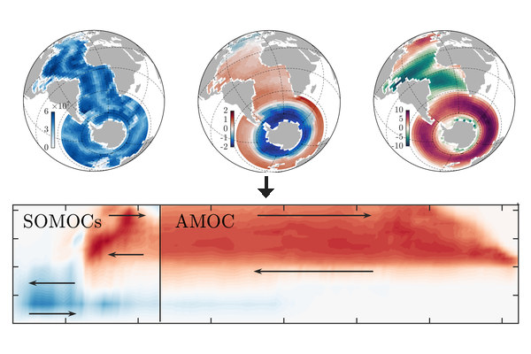
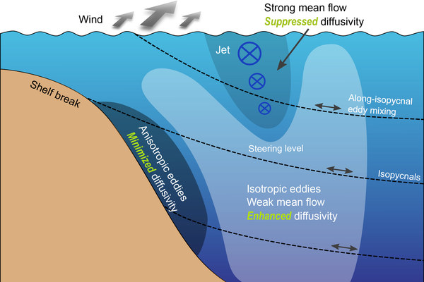
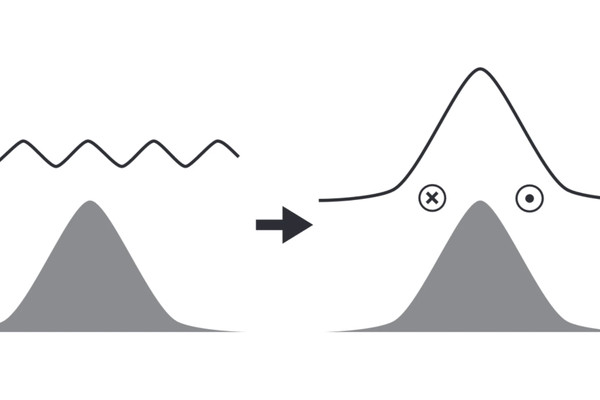
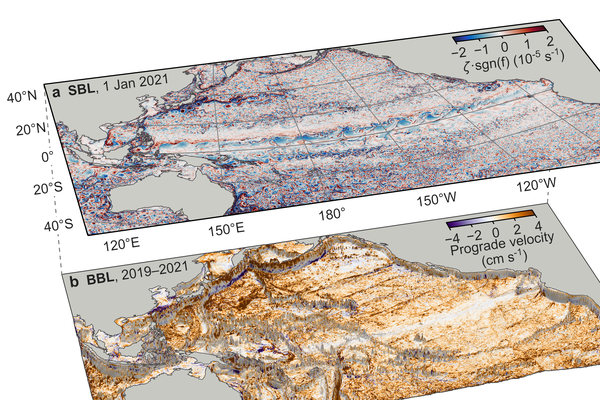
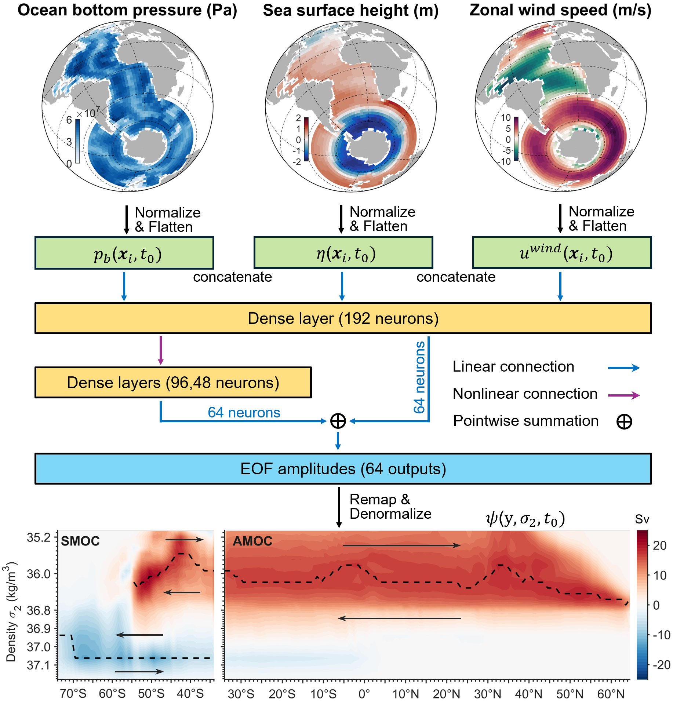
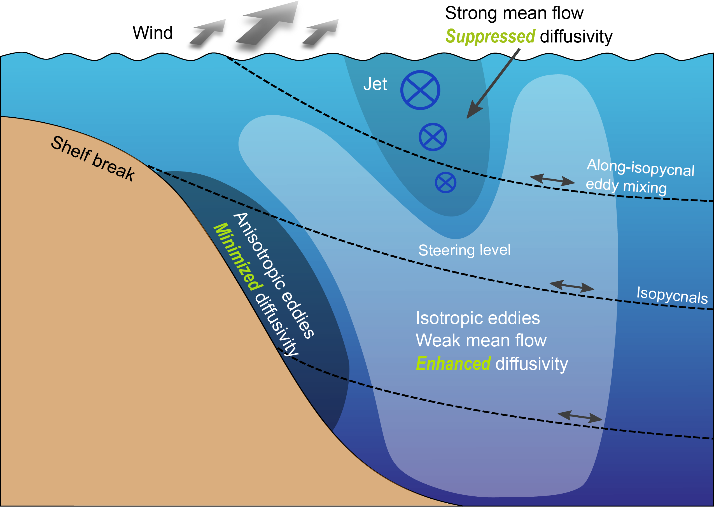
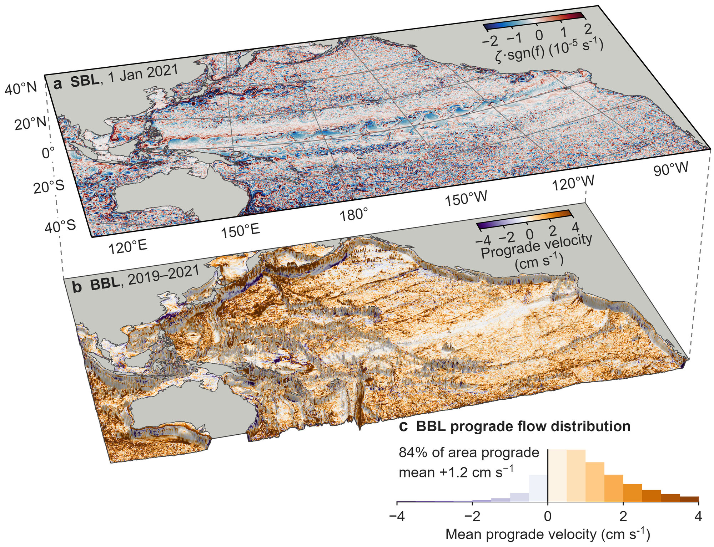
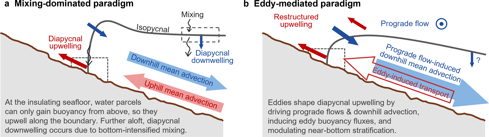

<!-- Layout classes are styled in _sass/_research.scss; the "On this page" list in the front matter appears in the sidebar on desktop.
Overview cards: research-overview--text on the nav below shows text-only cards with one-line summaries. Remove that class to show the card images instead:
images/thumb_*.jpg, 3:2 landscape, 1200x800 px recommended (600x400 at least), always shown whole. Linking a figure to itself opens it full size in a lightbox.
Every block of a section, figures included, ends at the text measure (two thirds of the column), so text and figures share both edges. -->

My research asks: <em>How do mesoscale eddies interact with seafloor topography, and how does this interaction modulate the ocean’s overturning circulation?</em> I approach it with theory, simulations, and machine learning.

<nav class="research-overview research-overview--text" aria-label="Research projects">
  <a href="#moc-reconstruction">
    
    
      01
      MOC reconstruction
      We use deep learning to reconstruct the MOC from satellite observations.
    
  </a>
  <a href="#eddy-parameterization">
    
    
      02
      Eddy parameterization
      We propose topography-aware physics-based and machine-learning-augmented schemes.
    
  </a>
  <a href="#abyssal-prograde-flows">
    
    
      03
      Abyssal prograde flows
      Driven by eddy potential vorticity mixing and strongest over intermediate slopes.
    
  </a>
  <a href="#bottom-boundary-upwelling">
    
    
      04
      Eddy-mediated upwelling
      How eddies and prograde flows shape diapycnal upwelling along slopes.
    
  </a>
</nav>

<section class="research-project" id="moc-reconstruction">
  <header class="research-project__header">
    <h2>01 Reconstructing the meridional overturning circulation using machine learning</h2>
    
Observing arrays measure the meridional overturning circulation (MOC) at only a few Atlantic latitudes. We developed NeurMOC, a deep-learning reconstruction of MOC changes since 2003 from satellite observations.

  </header>
  
We find evidence of Atlantic MOC declines and, in the Southern Ocean, a strengthening mid-depth cell and a weakening abyssal cell (<a href="https://doi.org/10.22541/essoar.15004679/v1">Wei et al. 2026, preprint</a>).

  
<a href="/neurmoc/">Explore the interactive <strong>NeurMOC</strong> viewer</a>

  <figure class="research-figure">
    
    <figcaption>Dual-branch neural network mapping bottom pressure, sea surface height, and zonal wind to MOC changes.</figcaption>
  </figure>
  

    <h3>Key papers</h3>
    <ul>
      <li><b>Wei, H.</b>, Stewart, A. L., Medvedev, A., Srinivasan, K., Solodoch, A., Manucharyan, G., &amp; Hogg, A. (2026). <a href="https://doi.org/10.22541/essoar.15004679/v1">Deep learning unlocks satellite-based monitoring of the global ocean overturning circulation</a>. Preprint, ESS Open Archive.</li>
      <li>Medvedev, A., <b>Wei, H.</b>, Armour, K. C., Srinivasan, K., Solodoch, A., Stewart, A. L., &amp; Manucharyan, G. (2026). <a href="https://doi.org/10.22541/essoar.15002298/v1">Basin-wide sea-surface observations reveal post-2000 emergence of AMOC weakening</a>. Preprint, ESS Open Archive.</li>
      <li><b>Wei, H.</b>, Srinivasan, K., Stewart, A. L., Solodoch, A., Manucharyan, G., &amp; Hogg, A. (2025). <a href="https://doi.org/10.1029/2024MS004915">Full-depth reconstruction of long-term meridional overturning circulation variability from satellite-measurable quantities via machine learning</a>. Journal of Advances in Modeling Earth Systems.</li>
    </ul>
  

</section>

<section class="research-project" id="eddy-parameterization">
  <header class="research-project__header">
    <h2>02 Mesoscale eddy parameterization over sloping topography</h2>
    
Mesoscale eddies over continental shelves and slopes mediate exchanges between coastal seas and the open ocean, but widely used parameterizations, developed primarily for the open ocean, do not adequately represent shelf/slope eddy transports. We developed eddy parameterizations that work in both settings.

  </header>
  <figure class="research-figure">
    
    <figcaption>Along-isopycnal eddy diffusivity under upwelling-favorable winds: suppressed in the jet, minimized where the steep slope makes eddies anisotropic, enhanced offshore.</figcaption>
  </figure>
  

    <h3>Key papers</h3>
    <ul>
      <li><b>Wei, H.</b>, Wang, Y., &amp; Mak, J. (2024). <a href="https://doi.org/10.1175/JPO-D-23-0152.1">Parameterizing eddy buoyancy fluxes across prograde shelf/slope fronts using a slope-aware GEOMETRIC closure</a>. Journal of Physical Oceanography.</li>
      <li>Xie, C.*, <b>Wei, H.</b>*, &amp; Wang, Y. (2023a). <a href="https://doi.org/10.1175/JPO-D-23-0017.1">Bathymetry-aware mesoscale eddy parameterizations across upwelling slope fronts: A machine learning-augmented approach</a>. Journal of Physical Oceanography. (*Contributed equally)</li>
      <li>Xie, C., <b>Wei, H.</b>, &amp; Wang, Y. (2023b). <a href="https://doi.org/10.1029/2022MS003424">Impact of parameterized isopycnal diffusivity on shelf-ocean exchanges under upwelling-favorable winds: offline tracer simulations augmented by artificial neural network</a>. Journal of Advances in Modeling Earth Systems.</li>
      <li><b>Wei, H.</b>, Wang, Y., Stewart, A. L., &amp; Mak, J. (2022). <a href="https://doi.org/10.1029/2022MS003229">Scalings for eddy buoyancy fluxes across prograde shelf/slope fronts</a>. Journal of Advances in Modeling Earth Systems. (Issue cover)</li>
      <li><b>Wei, H.</b>, &amp; Wang, Y. (2021). <a href="https://doi.org/10.1029/2021MS002498">Full-depth scalings for isopycnal eddy mixing across continental slopes under upwelling-favorable winds</a>. Journal of Advances in Modeling Earth Systems. (Issue cover)</li>
    </ul>
  

</section>

<section class="research-project" id="abyssal-prograde-flows">
  <header class="research-project__header">
    <h2>03 Formation of abyssal prograde flows via eddy potential vorticity mixing</h2>
    
Abyssal currents over sloping seafloors tend to flow prograde, with shallower water to the right in the Northern Hemisphere. We show how eddy potential vorticity mixing drives them. We derive a scaling for the strength of eddy-driven abyssal prograde flow.

  </header>
  <figure class="research-figure">
    
    <figcaption>Prevalence of abyssal prograde flow in an eddy-resolving Pacific simulation.</figcaption>
  </figure>
  

    <h3>Key paper</h3>
    <ul>
      <li><b>Wei, H.</b>, Stewart, A. L., McWilliams, J. C., &amp; Capó, E. (2026). <a href="https://doi.org/10.1175/JPO-D-25-0196.1">Formation of abyssal downwelling-favorable prograde flows via mesoscale eddy potential vorticity mixing</a>. Journal of Physical Oceanography.</li>
    </ul>
  

</section>

<section class="research-project" id="bottom-boundary-upwelling">
  <header class="research-project__header">
    <h2>04 Mesoscale eddy-mediated diapycnal upwelling in the ocean’s sloping bottom boundary</h2>
    
Dense abyssal waters are thought to upwell diapycnally along sloping boundaries, yet eddy-driven prograde currents there induce near-bottom <em>downslope</em> Ekman transport. We are investigating how these currents interact with mixing-driven upwelling.

  </header>
  <figure class="research-figure">
    
    <figcaption>Two paradigms of near-bottom diapycnal upwelling: mixing‑dominated (a, adapted from <a href="https://doi.org/10.1175/JPO-D-15-0244.1">Ferrari et al. 2016</a>) and eddy-mediated (b, based on our diagnostics).</figcaption>
  </figure>
</section>

