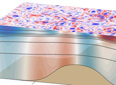
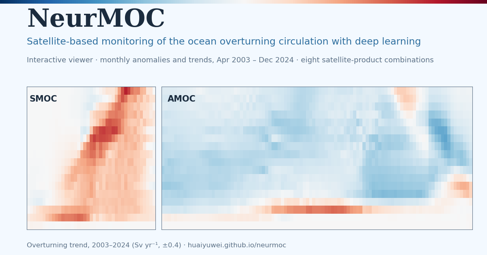
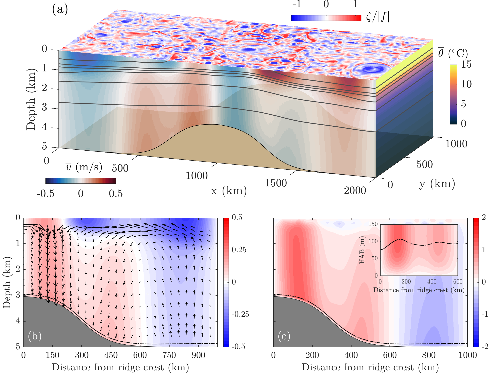
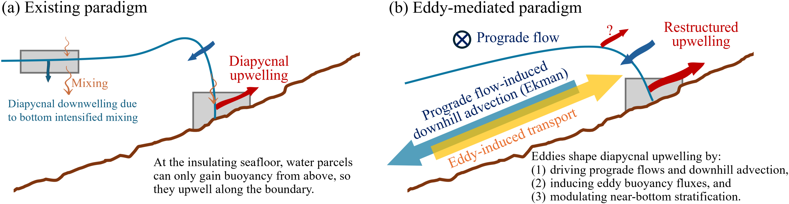

---
layout: archive
title: "Research"
permalink: /research/
author_profile: true
---

<!-- Layout classes are styled in _sass/_research.scss. Overview thumbnails are 240x176 crops saved as images/thumb_*.jpg. Linking an image to itself opens it full size in a lightbox. -->

<nav class="research-overview" aria-label="Research projects">
  <a href="#moc-reconstruction">
    
    Reconstructing the Meridional Overturning Circulation Using Machine Learning
  </a>
  <a href="#eddy-parameterization">
    
    Mesoscale Eddy Parameterization over Sloping Topography
  </a>
  <a href="#abyssal-prograde-flows">
    
    Formation of Abyssal Prograde Flows via Eddy Potential Vorticity Mixing
  </a>
  <a href="#bottom-boundary-upwelling">
    
    Mesoscale Eddy-Mediated Diapycnal Upwelling in the Ocean’s Sloping Bottom Boundary
  </a>
</nav>

<section class="research-project" id="moc-reconstruction">
  <h2>🎰 Reconstructing the Meridional Overturning Circulation Using Machine Learning</h2>
  

    

      
We developed a dual-branch neural network that uses satellite-measurable quantities (such as ocean bottom pressure, sea surface height, and wind stress) to reconstruct the meridional overturning circulation (MOC) in both the Atlantic Ocean and the Southern Ocean (<a href="https://doi.org/10.1029/2024MS004915">Wei et al. 2025</a>).

      <a class="research-cta" href="/neurmoc/">
        
        Explore the interactive NeurMOC viewer for the reconstructed latitude-density space MOC using real-world satellite data. (fun! click!)
      </a>
    

    <figure class="research-figure">
      
    </figure>
  

  <figure class="research-figure">
    <video controls preload="metadata" playsinline width="2956" height="1998">
      <source src="/videos/Truth_Vs_Reconstruction.mp4" type="video/mp4">
      Your browser does not support the video tag.
    </video>
    <figcaption>Animation comparing diagnosed vs. reconstructed MOC on decadal and longer timescales in the ACCESS-ESM1.5 preindustrial simulation.</figcaption>
  </figure>
</section>

<section class="research-project" id="eddy-parameterization">
  <h2>🌀 Mesoscale Eddy Parameterization over Sloping Topography</h2>
  
My doctoral research focused on parameterizing mesoscale eddy flux over sloping seafloors across both prograde (left video) and retrograde fronts (right video). We developed slope-aware parameterization schemes for both eddy advection and eddy diffusion, and some of these parameterizations have been implemented into MITgcm.

  

    <figure class="research-figure">
      <video controls preload="metadata" playsinline width="1496" height="1382">
        <source src="/videos/Prograde.mp4" type="video/mp4">
        Your browser does not support the video tag.
      </video>
      <figcaption>Prograde front</figcaption>
    </figure>
    <figure class="research-figure">
      <video controls preload="metadata" playsinline width="1496" height="1382">
        <source src="/videos/retrograde.mp4" type="video/mp4">
        Your browser does not support the video tag.
      </video>
      <figcaption>Retrograde front</figcaption>
    </figure>
  

  

    

      
We found that, apart from the mean-flow suppression effect, eddy anisotropy induced by steep topography shapes both the horizontal and vertical structures of cross-shore eddy diffusion. Heuristically speaking, steep topography “squeezes” eddies, making them highly anisotropic and inefficient at stirring tracers cross-shore (<a href="https://doi.org/10.1029/2021MS002498">Wei &amp; Wang 2021</a>).

    

    <figure class="research-figure">
      
    </figure>
  

  

    

      
Existing eddy parameterizations cannot constrain eddy advection across continental slopes. We proposed a slope-aware GEOMETRIC scaling that incorporates topographic suppression effects via analytical functions of the slope Burger number (<a href="https://doi.org/10.1029/2022MS003229">Wei et al. 2022</a>; <a href="https://doi.org/10.1175/JPO-D-23-0152.1">Wei et al. 2024</a>).

    

    <figure class="research-figure">
      
    </figure>
  

</section>

<section class="research-project" id="abyssal-prograde-flows">
  <h2>♆ Formation of Abyssal Prograde Flows via Eddy Potential Vorticity Mixing</h2>
  

    

      
Observations and simulations have revealed widespread prograde mean flows (currents aligned with the direction of topographic Rossby wave propagation along isobaths) over sloping topography in the abyssal ocean. Using idealized simulations, we show that prograde flows (red shading in the bottom left panel) are driven by eddy momentum fluxes (black arrows) resulting from mesoscale eddy stirring of potential vorticity (PV) gradients induced by the sloping seafloor. We found that eddy PV stirring becomes much less efficient over steeper slopes, resulting in reduced PV mixing and weaker prograde flows, despite larger background PV gradients induced by the steep seafloor (<a href="https://doi.org/10.1175/JPO-D-25-0196.1">Wei et al. 2026</a>).

    

    <figure class="research-figure">
      
    </figure>
  

</section>

<section class="research-project" id="bottom-boundary-upwelling">
  <h2>♆ Mesoscale Eddy-Mediated Diapycnal Upwelling in the Ocean’s Sloping Bottom Boundary</h2>
  
The modern view of the abyssal overturning circulation return pathway suggests that dense water rises primarily through diapycnal upwelling within thin bottom boundary layers along sloping ocean boundaries. We are investigating how mesoscale eddies and prograde flows influence this slope-adjacent upwelling paradigm.

  <figure class="research-figure">
    
  </figure>
</section>
