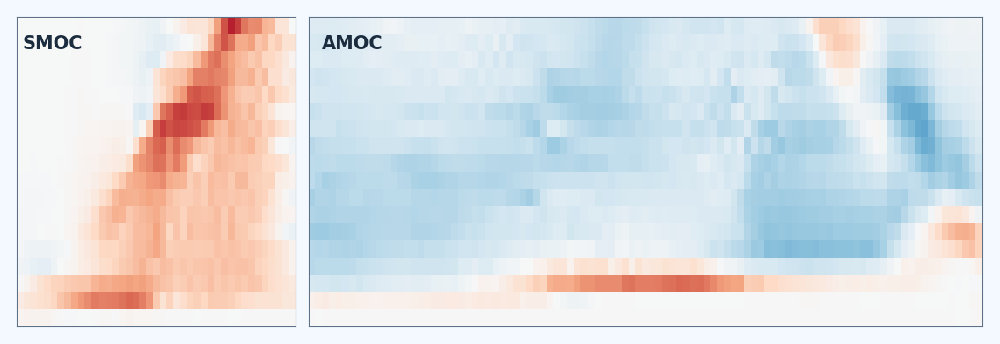
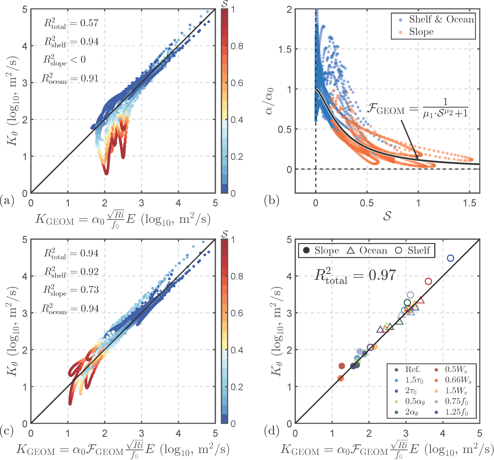
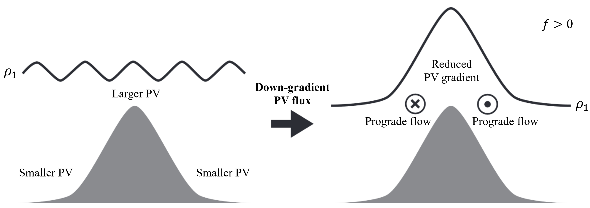

<!-- Layout classes are styled in _sass/_research.scss; the "On this page" list in the front matter appears in the sidebar on desktop.
Overview cards: research-overview--text on the nav below shows text-only cards with one-line summaries. Remove that class to show the card images instead:
images/thumb_*.jpg, 3:2 landscape, 1200x800 px recommended (600x400 at least), always shown whole. Linking a figure to itself opens it full size in a lightbox. -->

A central question guiding my research is: <em>What governs ocean circulation across scales, and how is it changing in a warming climate?</em> I pair machine learning with dynamics: neural networks learn circulation from sparse observations and represent unresolved processes in models, while physical theory guides their design and interprets what they learn. My work enables satellite-based monitoring of the ocean overturning circulation using deep learning, improves the representation of eddy-driven exchanges in ocean models, and advances understanding of abyssal circulation over sloping seafloors.

<nav class="research-overview research-overview--text" aria-label="Research projects">
  <a href="#moc-reconstruction">
    
    
      01
      MOC reconstruction
      NeurMOC uses deep learning to reconstruct Atlantic and Southern Ocean overturning changes since 2003 from satellite observations.
    
  </a>
  <a href="#eddy-parameterization">
    
    
      02
      Eddy parameterization
      Steep slopes make eddies anisotropic and inefficient at cross-slope stirring. We represent such topographic effects in physics-based and machine-learning-augmented parameterizations.
    
  </a>
  <a href="#abyssal-prograde-flows">
    
    
      03
      Abyssal prograde flows
      Eddy homogenization of topographic potential vorticity gradients drives abyssal prograde flows, which strengthen with slope before weakening over steep slopes.
    
  </a>
  <a href="#bottom-boundary-upwelling">
    
    
      04
      Eddy-mediated upwelling
      Ongoing work on how mesoscale eddies and prograde flows influence diapycnal upwelling of dense water along sloping ocean boundaries.
    
  </a>
</nav>

<section class="research-project" id="moc-reconstruction">
  <header class="research-project__header">
    
01Monitoring the overturning from satellites

    <h2>Reconstructing the Meridional Overturning Circulation Using Machine Learning</h2>
    
The meridional overturning circulation (MOC) regulates Earth’s climate by redistributing heat and salt, yet direct observing arrays cover only a few Atlantic latitudes. I address this observational gap by linking the MOC to satellite observations through deep learning.

  </header>
  
In a model-based demonstration, we showed that a dual-branch neural network can reconstruct the strength and vertical structure of MOC variability from satellite-measurable quantities such as ocean bottom pressure, sea surface height, and wind (<a href="https://doi.org/10.1029/2024MS004915">Wei et al. 2025</a>). Building on this demonstration, I developed NeurMOC, a reconstruction of MOC changes across the Atlantic and Southern Oceans since 2003 based on satellite observations.

  

    

      <a class="research-cta" href="/neurmoc/">
        
        Explore the interactive <strong>NeurMOC</strong> viewer: MOC changes in latitude–density space, reconstructed from satellite observations since 2003.
      </a>
      
Using NeurMOC, we find evidence of Atlantic MOC declines, alongside strengthening of the Southern Ocean’s mid-depth overturning cell and weakening of its abyssal cell (<a href="https://doi.org/10.22541/essoar.15004679/v1">Wei et al. 2026, preprint</a>). We validated the approach through cross-model testing and comparison with in-situ observations at 26.5°N, and quantified reconstruction uncertainty. Attribution analysis shows that the network uses physically plausible local and remote signals consistent with geostrophic constraints.

    

    <figure class="research-figure">
      
      <figcaption>Dual-branch neural network: linear and nonlinear branches map bottom pressure, sea surface height, and zonal wind to the MOC in latitude–density space.</figcaption>
    </figure>
  

  

    <h3>Key papers</h3>
    <ul>
      <li><b>Wei, H.</b>, Stewart, A. L., Medvedev, A., Srinivasan, K., Solodoch, A., Manucharyan, G., &amp; Hogg, A. (2026). <a href="https://doi.org/10.22541/essoar.15004679/v1">Deep learning unlocks satellite-based monitoring of the global ocean overturning circulation</a>. Preprint, ESS Open Archive.</li>
      <li>Medvedev, A., <b>Wei, H.</b>, Armour, K. C., Srinivasan, K., Solodoch, A., Stewart, A. L., &amp; Manucharyan, G. (2026). <a href="https://doi.org/10.22541/essoar.15002298/v1">Basin-wide sea-surface observations reveal post-2000 emergence of AMOC weakening</a>. Preprint, ESS Open Archive.</li>
      <li><b>Wei, H.</b>, Srinivasan, K., Stewart, A. L., Solodoch, A., Manucharyan, G., &amp; Hogg, A. (2025). <a href="https://doi.org/10.1029/2024MS004915">Full-depth reconstruction of long-term meridional overturning circulation variability from satellite-measurable quantities via machine learning</a>. Journal of Advances in Modeling Earth Systems.</li>
    </ul>
  

</section>

<section class="research-project" id="eddy-parameterization">
  <header class="research-project__header">
    
02Representing eddies in ocean models

    <h2>Mesoscale Eddy Parameterization over Sloping Topography</h2>
    
Mesoscale eddies over continental shelves and slopes mediate exchanges between coastal seas and the open ocean, but widely used parameterizations, developed primarily for the open ocean, do not adequately represent shelf/slope eddy transports. I developed eddy parameterizations that work in both settings.

  </header>
  
Around Antarctica, for example, shelf/slope eddies transport heat toward ice shelves. During my Ph.D., I identified, explained, and represented the leading-order effects of sloping seafloors on eddy exchanges across both prograde and retrograde fronts (videos below).

  

    <figure class="research-figure">
      <video controls preload="metadata" playsinline width="1496" height="1382">
        <source src="/videos/Prograde.mp4" type="video/mp4">
        Your browser does not support the video tag.
      </video>
      <figcaption><strong>Prograde front.</strong> Surface temperature in an eddy-resolving simulation, with the mean along-slope flow aligned with topographic Rossby wave propagation.</figcaption>
    </figure>
    <figure class="research-figure">
      <video controls preload="metadata" playsinline width="1496" height="1382">
        <source src="/videos/retrograde.mp4" type="video/mp4">
        Your browser does not support the video tag.
      </video>
      <figcaption><strong>Retrograde front.</strong> Surface temperature in an eddy-resolving simulation, with the mean along-slope flow opposing topographic Rossby wave propagation.</figcaption>
    </figure>
  

  

    

      
Heuristically speaking, steep topography “squeezes” eddies, making them highly anisotropic and inefficient at stirring tracers cross-shore. We found that, apart from the mean-flow suppression effect, this anisotropy shapes both the horizontal and vertical structures of cross-shore eddy diffusion (<a href="https://doi.org/10.1029/2021MS002498">Wei &amp; Wang 2021</a>).

    

    <figure class="research-figure">
      
      <figcaption>Along-isopycnal eddy diffusivity across a continental slope under upwelling-favorable winds: suppressed in the jet, minimized over the steep slope where eddies are anisotropic, enhanced offshore.</figcaption>
    </figure>
  

  

    

      
Existing eddy parameterizations cannot constrain eddy advection across continental slopes (panel a). We proposed a slope-aware GEOMETRIC scaling that incorporates topographic suppression effects via analytical functions of the slope Burger number (<a href="https://doi.org/10.1029/2022MS003229">Wei et al. 2022</a>).

      
We also developed a machine-learning-augmented scheme (<a href="https://doi.org/10.1175/JPO-D-23-0017.1">Xie et al. 2023a</a>): neural networks trained on eddy-resolving simulations predict, from the resolved flow and bathymetry, the eddy energy that sets an energetically constrained Gent–McWilliams diffusivity and the cross-slope eddy momentum flux. I implemented this scheme and the slope-aware GEOMETRIC closure (<a href="https://doi.org/10.1175/JPO-D-23-0152.1">Wei et al. 2024</a>) in ocean general circulation models, including MITgcm. Prognostic evaluations in idealized configurations show improved temperature structure and baroclinic transport relative to widely used open-ocean schemes.

    

    <figure class="research-figure">
      
      <figcaption>Diagnosed eddy diffusivity against the GEOMETRIC scaling without (a) and with (c, d) a slope factor that decreases with the slope Burger number (b).</figcaption>
    </figure>
  

  

    <h3>Key papers</h3>
    <ul>
      <li><b>Wei, H.</b>, Wang, Y., &amp; Mak, J. (2024). <a href="https://doi.org/10.1175/JPO-D-23-0152.1">Parameterizing eddy buoyancy fluxes across prograde shelf/slope fronts using a slope-aware GEOMETRIC closure</a>. Journal of Physical Oceanography.</li>
      <li>Xie, C.*, <b>Wei, H.</b>*, &amp; Wang, Y. (2023a). <a href="https://doi.org/10.1175/JPO-D-23-0017.1">Bathymetry-aware mesoscale eddy parameterizations across upwelling slope fronts: A machine learning-augmented approach</a>. Journal of Physical Oceanography. (*Contributed equally)</li>
      <li>Xie, C., <b>Wei, H.</b>, &amp; Wang, Y. (2023b). <a href="https://doi.org/10.1029/2022MS003424">Impact of parameterized isopycnal diffusivity on shelf-ocean exchanges under upwelling-favorable winds: offline tracer simulations augmented by artificial neural network</a>. Journal of Advances in Modeling Earth Systems.</li>
      <li><b>Wei, H.</b>, Wang, Y., Stewart, A. L., &amp; Mak, J. (2022). <a href="https://doi.org/10.1029/2022MS003229">Scalings for eddy buoyancy fluxes across prograde shelf/slope fronts</a>. Journal of Advances in Modeling Earth Systems. (Issue cover)</li>
      <li><b>Wei, H.</b>, &amp; Wang, Y. (2021). <a href="https://doi.org/10.1029/2021MS002498">Full-depth scalings for isopycnal eddy mixing across continental slopes under upwelling-favorable winds</a>. Journal of Advances in Modeling Earth Systems. (Issue cover)</li>
    </ul>
  

</section>

<section class="research-project" id="abyssal-prograde-flows">
  <header class="research-project__header">
    
03Understanding abyssal circulation

    <h2>Formation of Abyssal Prograde Flows via Eddy Potential Vorticity Mixing</h2>
    
Abyssal currents over sloping seafloors preferentially flow in the “prograde” direction, with shallower water to the right in the Northern Hemisphere (left in the Southern). We show that mesoscale eddy homogenization of topographic potential vorticity (PV) gradients generates momentum fluxes that drive these currents.

  </header>
  <figure class="research-figure">
    
    <figcaption>How eddy PV mixing drives prograde flow, drawn for the Northern Hemisphere (adapted from <a href="https://doi.org/10.1175/JPO-D-11-048.1">Marshall et al. 2012</a>). The sloping seafloor sets up a strong PV gradient in the abyssal layer. Down-gradient eddy PV fluxes tilt the isopycnal (solid line) in the same direction as the seafloor, and by thermal wind balance the tilt implies a vertical shear that favors prograde flow.</figcaption>
  </figure>
  
We used idealized simulations of eddying flow over a ridge. Over the ridge flank, eddy momentum fluxes drive the prograde flow.

  
The strength of the prograde flow increases with bottom slope before declining over steep slopes, where rapid topographic-wave propagation suppresses eddy stirring, reducing PV mixing despite the larger background PV gradients. From the leading-order momentum balance, we derived a scaling that links current strength to eddy energy, bottom slope, stratification, and friction (<a href="https://doi.org/10.1175/JPO-D-25-0196.1">Wei et al. 2026</a>).

  
In a realistic Pacific simulation (below), the time-mean flow in the bottom boundary layer is prograde over most of the deep seafloor.

  <figure class="research-figure research-figure--measure">
    
    <figcaption>Realistic 6-km Pacific simulation: surface vorticity on 1 January 2021 (a) above the time-mean (2019–2021) prograde velocity in the bottom boundary layer (b). Over seafloor deeper than 2,000 m, the flow is prograde across 84% of the area (c).</figcaption>
  </figure>
  

    <h3>Key paper</h3>
    <ul>
      <li><b>Wei, H.</b>, Stewart, A. L., McWilliams, J. C., &amp; Capó, E. (2026). <a href="https://doi.org/10.1175/JPO-D-25-0196.1">Formation of abyssal downwelling-favorable prograde flows via mesoscale eddy potential vorticity mixing</a>. Journal of Physical Oceanography.</li>
    </ul>
  

</section>

<section class="research-project" id="bottom-boundary-upwelling">
  <header class="research-project__header">
    
04Ongoing: eddies and bottom mixing

    <h2>Mesoscale Eddy-Mediated Diapycnal Upwelling in the Ocean’s Sloping Bottom Boundary</h2>
    
A growing body of literature emphasizes that dense abyssal waters return toward the surface through diapycnal upwelling along sloping boundaries. Yet prograde currents over these slopes induce near-bottom <em>downslope</em> Ekman transport. We are investigating how eddy-driven currents interact with mixing-driven upwelling.

  </header>
  <figure class="research-figure">
    
    <figcaption>Two paradigms of near-bottom diapycnal upwelling over a sloping seafloor: mixing-dominated (a) and eddy-mediated (b).</figcaption>
  </figure>
  
We examine these paradigms in an idealized eddying ridge simulation and a realistic Pacific simulation, comparing their near-bottom buoyancy budgets, split into mixing, mean advection, and eddy advection.

</section>

